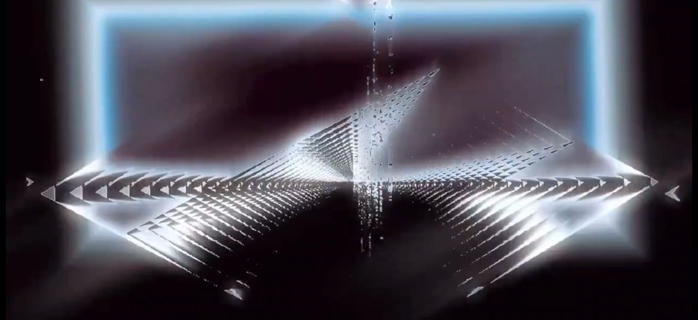

# ETERNITYEON-



### LAST EON · Generative Immersive Digital Experience


## Visione

LAST EON considera il dato non solo come informazione, ma come materiale da osservare, interpretare e trasformare.

La ricerca si sviluppa attorno a tre concetti:

- **Segnale** — ciò che viene rilevato o ricevuto.
- **Relazione** — i legami tra ambiente, persone e sistemi digitali.
- **Trasformazione** — il passaggio dal dato a una forma visiva, sonora o narrativa.

Il progetto è in evoluzione e unisce sperimentazione artistica, sviluppo digitale e ricerca.

## Stack tecnologico

Il progetto può includere:

- **TouchDesigner** per la rete visuale interattiva.
- **Arduino** per acquisire dati da sensori analogici.
- **Python** per leggere la seriale e inoltrare i dati.
- **OSC** per trasmettere i valori a TouchDesigner.
- **GLSL** per eventuali shader personalizzati.

## Flusso dati Arduino–TouchDesigner

Il flusso previsto per l’input da Arduino è:

```text
Sensori → Arduino → USB/seriale → bridge Python → OSC/UDP → TouchDesigner
```

Lo sketch Arduino invia valori separati da virgole. Il bridge Python li inoltra tramite OSC a TouchDesigner.

Configurazione predefinita prevista:

- Baud rate seriale: `9600`
- Host OSC: `127.0.0.1`
- Porta OSC: `10000`

Verifica porte, indirizzi OSC, scheda e sensori in base alla configurazione effettivamente utilizzata.

## Componente web

`index.html` e `project.json` sono utilizzati dalla componente web. Se la pagina deve caricare `project.json` tramite JavaScript, mantieni entrambi i file nella posizione prevista dal codice.

Per provare la repository con un server locale, dalla cartella principale esegui:

```bash
python -m http.server 8000
```

Poi apri `http://localhost:8000` nel browser.

## Documentazione ed esempi

- [Ottimizzazione memoria e integrazione WebSocket](docs/OTTIMIZZAZIONE_MEMORIA_WEBSOCKET.md)
- [Esempio DataCore](examples/datacore_memory_aware.py)
- [Client WebSocket](examples/websocket_client.py)

Gli esempi sono prototipi e potrebbero richiedere configurazione o modifiche prima dell’uso.

## Stato del progetto

**Prototipo in evoluzione.** La presenza di codice e documentazione non implica che l’intero sistema sia stato collaudato. Verifica ogni componente con l’hardware e le versioni software che intendi utilizzare.

Prima di eseguire script che modificano un progetto TouchDesigner, controlla il codice e fai una copia del progetto.

## Sicurezza e limiti

- Verifica cablaggio, tensioni, correnti e protezioni prima di collegare sensori o attuatori.
- Non lasciare attuatori incustoditi durante i test.
- I valori dei sensori non sono diagnosi mediche né misure scientifiche validate.
- Non pubblicare credenziali, token, chiavi o dati personali.
- Consulta il file `LICENSE` per le condizioni d’uso del progetto.

## Nota finale

LAST EON è un progetto artistico e tecnico in evoluzione. Questa repository raccoglie materiali, documentazione ed esempi; la validazione richiede test reali su hardware e software.

